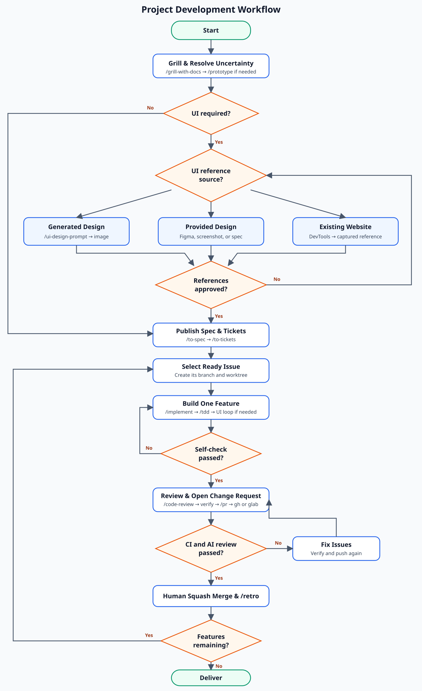
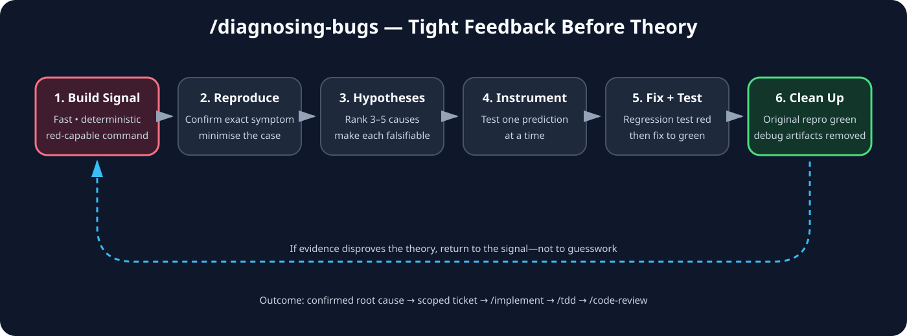
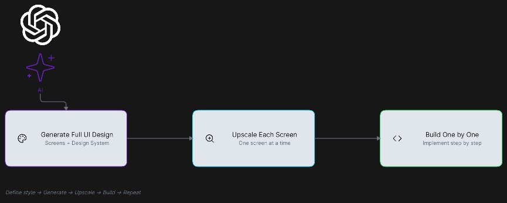
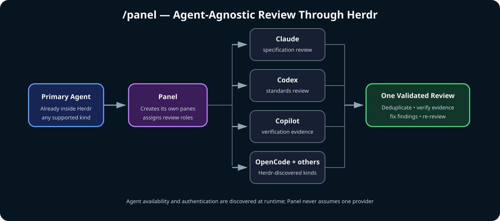
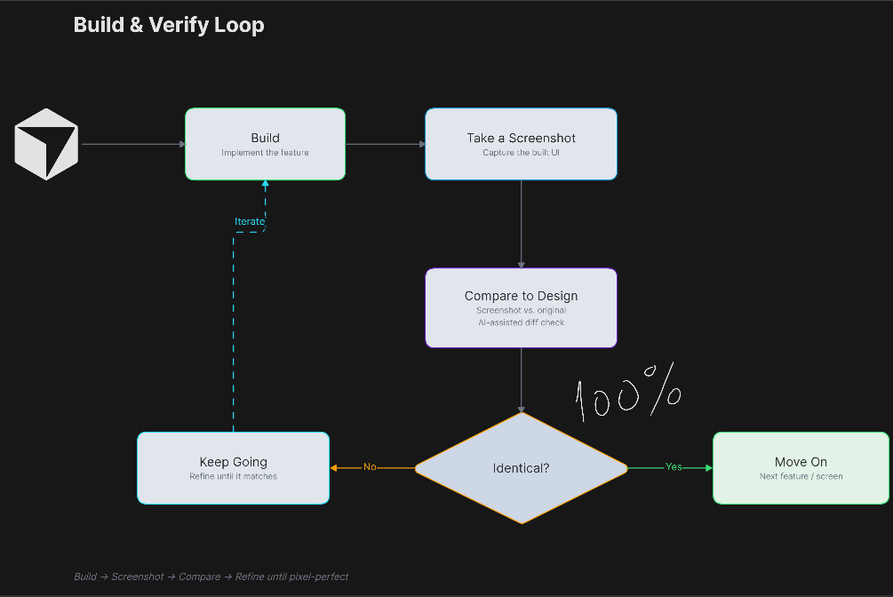

# Workflows



The development loop is **Grill or Diagnose → Design if needed → Spec → Tickets
→ Implement one ticket → Review → Open change request → CI and AI review →
Deliver → Retro**. Every implementation requires an issue in the configured
tracker.

Matt Pocock's vendored skills under [`.claude/skills/`](../.claude/skills/) are
the source of truth for the engineering method. Repository-owned skills only
fill UI and agent-orchestration gaps. When another agent does not expose the named
slash command, perform the equivalent step from its `SKILL.md`.

## 0. Configure the Repository

Run [`/setup-matt-pocock-skills`](../.claude/skills/setup-matt-pocock-skills/SKILL.md)
once. Configure the repository's issue tracker, retain the default triage
labels, and use the appropriate domain-document layout.

## 1. Sharpen or Diagnose

Run [`/grill-with-docs`](../.claude/skills/grill-with-docs/SKILL.md) for new
features and complex changes. It sharpens the idea while recording durable
domain language and architectural decisions.

For a bug, failure, or performance regression, run
[`/diagnosing-bugs`](../.claude/skills/diagnosing-bugs/SKILL.md). Build a tight,
red-capable reproduction loop before forming hypotheses, minimise the repro,
then turn it into a regression test at the highest correct seam. Publish the
confirmed fix as a scoped ticket before implementing it.



When a question needs a runnable answer, use
[`/prototype`](../.claude/skills/prototype/SKILL.md). Treat prototype code as
evidence, not production implementation.

Keep discovery, specification, and ticketing in one context when practical so
the decisions survive intact.

## 2. Approve UI References

Skip this phase when the work has no user interface. Choose one reference
source before publishing implementation tickets.

### Generated design

Run [`/ui-design-prompt`](../.claude/skills/ui-design-prompt/SKILL.md) from the
agreed product discussion, specification, or plan:

```text
/ui-design-prompt --aspect-ratio 16:9
```

Generate one overview containing every planned page in a shared design system.
Save the approved overview as `design/panels.png`.

### Provided design

Use the provided Figma frame or export, screenshot, mockup, or design-system
specification. Confirm which artifact applies to every required page, viewport,
and state.

### Authorized existing website

Record the permitted URLs, flows, states, and viewports. Capture complete
references with browser tooling. Reuse branding, text, imagery, fonts, and
other protected assets only with explicit authorization.

### Reference completion criterion

Before ticketing UI implementation:

1. Save every complete page as `design/<page-name>-reference.png`, adding
   viewport or state suffixes where needed.
2. Save only authorized implementation assets under `design/assets/`.
3. Obtain approval for the overview and every detailed page reference.



## 3. Publish the Specification and Tickets

Run [`/to-spec`](../.claude/skills/to-spec/SKILL.md) to publish the agreed
specification in the configured issue tracker. Then run
[`/to-tickets`](../.claude/skills/to-tickets/SKILL.md) to propose tracer-bullet
tickets and blocking edges. Approve the breakdown before it is published.

Each ticket must deliver a narrow, complete, independently verifiable behavior.
UI tickets identify their approved references, routes, viewports, states, and
acceptance criteria.

## 4. Select and Isolate One Ticket

Select an open ticket from the **frontier**: all its blockers are complete and
no implementation is already active. Create its conventionally named branch
and isolated Worktrunk worktree as described in
[`docs/agents/README.md`](agents/README.md).

Launch the primary agent inside Herdr. When the user explicitly requests Herdr
coordination, use the official [`/herdr`](../.claude/skills/herdr/SKILL.md)
skill to inspect panes, run commands, or coordinate additional agents. Matt's
skills remain authoritative for planning, implementation, and review; Herdr
provides the execution environment.

One issue owns one branch, worktree, agent session, and change request.

## 5. Implement One Ticket

Run [`/implement <ticket>`](../.claude/skills/implement/SKILL.md). It drives
[`/tdd`](../.claude/skills/tdd/SKILL.md), runs focused checks during development,
finishes with the full test suite, invokes
[`/code-review`](../.claude/skills/code-review/SKILL.md), and commits the result.

Follow `AGENTS.md`, repository conventions, the issue, glossary, and ADRs. Run
`pnpm run check` regularly and update documentation made inaccurate by the
change.

For UI tickets, run
[`/ui-implementation-loop <page-name>`](../.claude/skills/ui-implementation-loop/SKILL.md)
against the approved reference. Its existing-website mode covers authorized
website references without a separate wrapper skill.

For rigorous multi-agent verification, run
[`/panel`](../.claude/skills/panel/SKILL.md). Panel uses Herdr to create its own
review panes and supports any agent kind reported by the installed Herdr CLI,
including Claude, Codex, Copilot, and OpenCode. Resolve every valid finding
before opening the change request.





## 6. Verify and Open the Change Request

The implementation's final [`/code-review`](../.claude/skills/code-review/SKILL.md)
checks both documented standards and the originating specification. Resolve its
findings, run `pnpm run verify`, and audit the complete branch diff. Use Matt's
[`/pr`](../.claude/skills/pr/SKILL.md) as the source of truth for the pull- or
merge-request body.

Show the title, body, push command, and creation command for explicit approval
before changing the remote. After approval, push the branch and open exactly
one change request with the host-native tool:

- GitHub: `gh pr create`
- GitLab: `glab mr create`

Use the tracker's supported closing syntax to link the originating issue.

## 7. CI and AI Review

CI runs `pnpm run verify`. After
[automatic AI review is configured](repository-settings.md#automatic-ai-review),
CodeRabbit reviews bugs, security, tests, edge cases, conventions, and scope.

Apply valid findings, rerun the relevant focused checks and `pnpm run verify`,
push the fixes, and repeat until CI passes and every finding is resolved or
explicitly addressed.

## 8. Deliver and Improve

After approval, a human squash-merges the change request and removes its
worktree.
Run [`/retro`](../.claude/skills/retro/SKILL.md) before clearing the completed
session so navigation, checks, standards, and tooling can improve the next run.

If tickets remain, select another issue from the unblocked frontier and return
to **Select and Isolate One Ticket**. Correct an unsatisfactory result at its
own phase: sharpen unclear decisions, revise the specification or tickets, or
return an implementation to TDD and code review.

## Sources of Truth

Apply these sources in order:

1. `AGENTS.md`, conventions, architecture documentation, glossary, and ADRs
   define repository and technical constraints.
2. The tracker specification and ticket define scope, behavior, platform,
   viewport, states, and acceptance criteria.
3. `design/panels.png` defines the approved cross-page system, and
   `design/<page-name>-reference.png` defines the detailed visual target.
4. Tests and required checks provide executable verification.
5. Files under `design/assets/` support implementation; they are not references.

Functional and accessibility requirements remain authoritative over visual
fidelity. Report conflicting sources instead of guessing.
